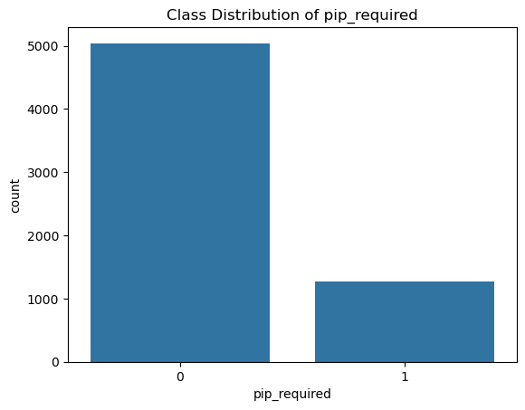
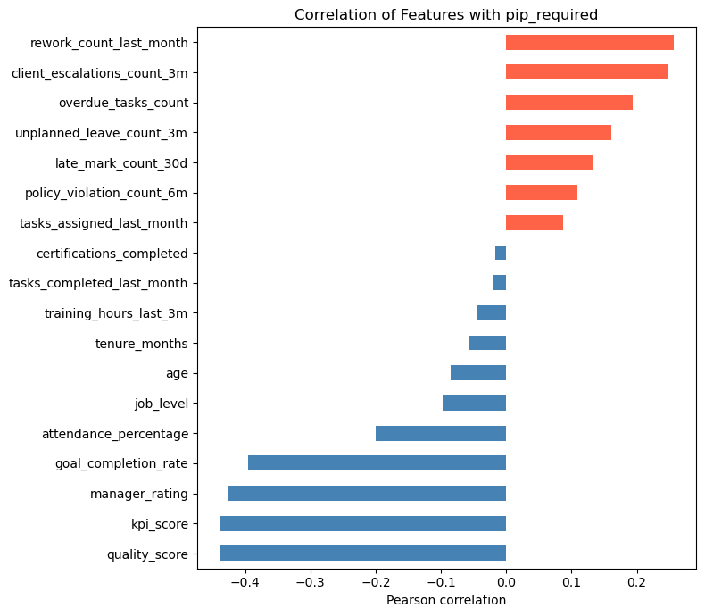
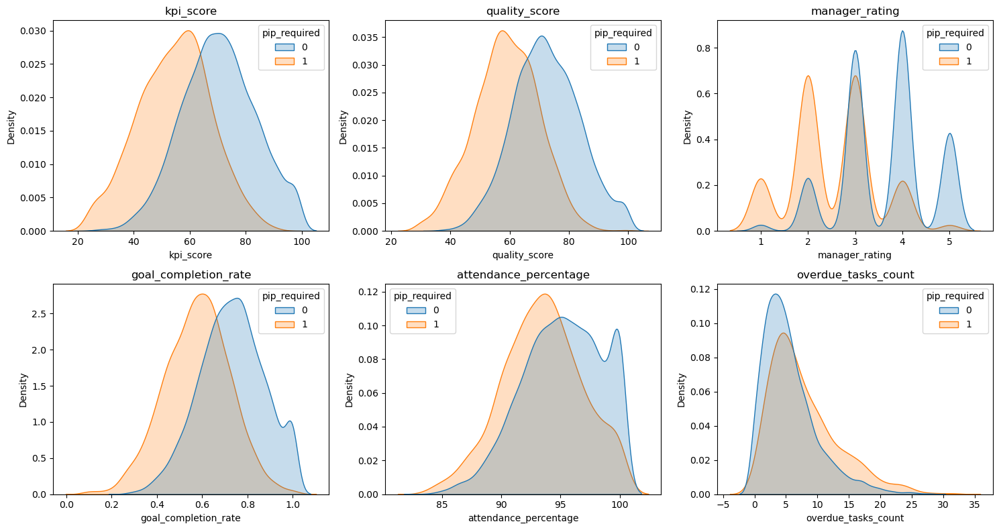
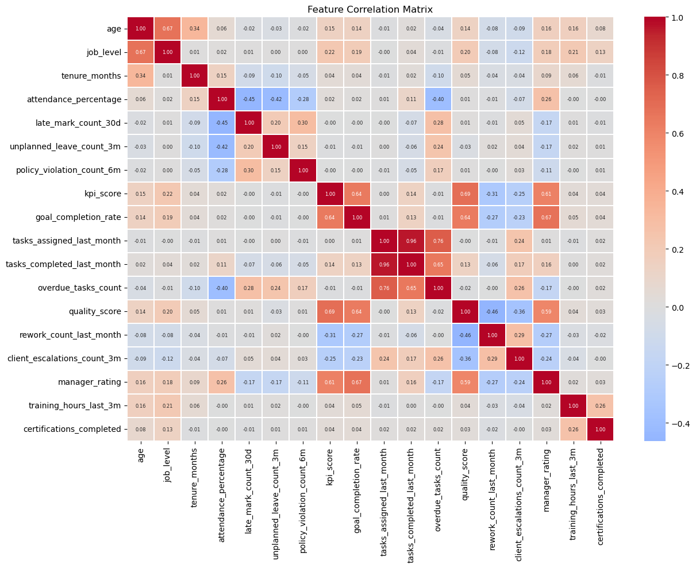
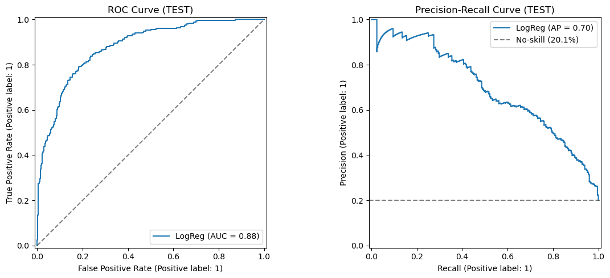
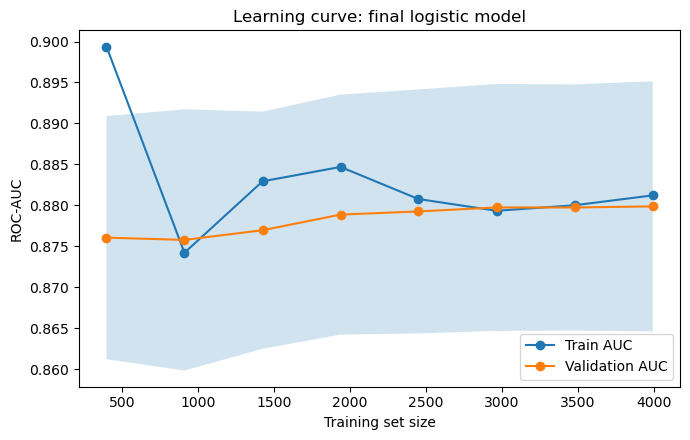

# 📉 Employee PIP Risk Prediction

A machine learning project that predicts which employees are likely to need a **Performance Improvement Plan (PIP)**, so HR can spot struggling employees early instead of checking everyone.

**Result in one line:** reviewing the top **37%** of employees (High + Medium tiers) finds about **84%** of the people who need a PIP, and the model ranks employees with a **ROC-AUC of 0.88**.

---

## Table of contents
1. [Problem](#problem)
2. [Data](#data)
3. [What we did](#what-we-did)
4. [What the data shows](#what-the-data-shows)
5. [Model results](#model-results)
6. [What drives a PIP](#what-drives-a-pip)
7. [Risk tiers for HR](#risk-tiers-for-hr)
8. [Limitations](#limitations)
9. [How to run](#how-to-run)

---

## Problem

Managers often notice struggling employees late. The company wants an early-warning list built from data it already has (performance, quality, workload, attendance and conduct).

**Goals**
1. Predict who is likely to need a PIP.
2. Find which factors matter most.
3. Turn scores into simple risk tiers HR can use.

Only about **20%** of employees need a PIP, so plain accuracy would be misleading (always saying "no PIP" is 80% accurate and catches nobody). The model is judged on:
- **ROC-AUC:** how well it ranks employees from low to high risk.
- **Recall:** of all employees who need a PIP, how many we catch.
- **Precision:** of the employees we flag, how many really need a PIP.



---

## Data

| Item | Detail |
|---|---|
| Size | 6,315 employees x 26 columns (6,240 after removing 75 duplicates) |
| Target | `pip_required` (1 = needs a PIP), about 20% |
| Performance | KPI score, quality score, goal completion, manager rating |
| Workload | tasks assigned, tasks completed, overdue tasks, rework |
| Attendance and conduct | attendance %, late marks, unplanned leaves, policy violations, client escalations |
| Profile | age, department, job role, job level, employment type, tenure |
| Not used | employee id, desk zone, laptop model (admin only) and **gender** (excluded for fairness) |
| Missing values | a few in six columns, each under 0.8% |

---

## What we did

1. **Cleaned the data:** removed duplicate employees *before* splitting, so the same person is never in both train and test.
2. **Explored it:** compared employees with and without a PIP.
3. **Built new features:** task completion rate, overdue ratio and an attendance risk index (ratios compare employees fairly regardless of workload).
4. **Split the data:** 80% train and 20% test, with the same PIP rate in both. All learning used the training data only.
5. **Built a baseline** logistic regression, then added **class weights** and chose a better cut-off.
6. **Compared models** (Logistic Regression, Random Forest, Gradient Boosting) with cross-validation.
7. **Simplified** to 12 useful features.
8. **Checked reliability and fairness,** and where the model makes mistakes.

---

## What the data shows

- Employees who need a PIP have **lower KPI, quality score, goal completion and manager rating**, and **more client escalations, rework and policy violations**.
- No single column separates the two groups, because the curves overlap, so the model combines many signals.
- PIP rates are higher in Customer Support (25.6%) and Operations (23.7%), and for junior employees (level 1: 25.6%, level 5: 12.8%).
- Gender makes no difference (20.4% Male, 19.8% Female), so it was not used.




Several features move together (for example tasks assigned and completed: 0.96). That is why raw task counts were replaced with ratios.



---

## Model results

| Model | CV ROC-AUC | Train ROC-AUC | Gap |
|---|---|---|---|
| **Logistic Regression (weighted)** | **0.876** | 0.883 | 0.007 |
| Random Forest | 0.869 | 0.981 | 0.112 |
| Gradient Boosting | 0.865 | 0.940 | 0.075 |

- The **simple logistic model wins.** The tree models memorise the training data (big gap) without ranking new employees any better.
- **12 features worked as well as 47** (CV AUC 0.880 against 0.876), so the final model uses the 12.
- **Test ROC-AUC is 0.881**, the same as cross-validation, so the model holds up on new employees. A bootstrap check gives a realistic range of **0.86 to 0.91**.
- At the default 0.5 cut-off the model caught only 47% of PIP cases. Class weights and a lower cut-off fixed that.
- Trying splines and boosted trees in a fair repeated cross-validation did not beat logistic regression, so about 0.88 AUC is the limit of what this data can tell us.



The learning curve shows training and validation AUC meeting at about 0.88 (gap 0.001), so the model is **not overfitting**, and more data of the same kind would not help much.



---

## What drives a PIP

Odds ratios from the logistic model (per 1 standard deviation; below 1 lowers risk, above 1 raises it):

| Feature | Odds ratio | Meaning |
|---|---|---|
| KPI score | 0.47 | Higher KPI roughly **halves** the odds of a PIP |
| Quality score | 0.51 | Same, almost as strong |
| Goal completion | 0.73 | Lower risk |
| Training hours | 0.83 | Lower risk |
| Manager rating | 0.85 | Lower risk |
| **Attendance risk index** | **1.70** | The strongest risk factor |
| Tasks assigned | 1.30 | Heavy workload adds risk |
| Overdue ratio | 1.25 | Late work |
| Rework | 1.23 | More rework, more risk |
| Policy violations / client escalations | 1.15 / 1.14 | More risk |

Department, employment type, age and tenure were **not significant** once performance was taken into account: the department gaps in the raw data come from performance, not from the department itself. These are associations, not proof of cause.

---

## Risk tiers for HR

Scores were turned into four tiers (cut-offs chosen on training data only). Results on the **test set** (1,248 employees, 251 who need a PIP):

| Tier | Employees | Need a PIP | PIP rate | Employees reviewed so far | PIP cases found so far |
|---|---|---|---|---|---|
| **High** | 196 | 134 | **68.4%** | 15.7% | 53.4% |
| **Medium** | 265 | 77 | 29.1% | 36.9% | **84.1%** |
| **Watch** | 110 | 16 | 14.5% | 45.8% | **90.4%** |
| **Low** | 677 | 24 | 3.5% | 100% | 100% |

**How to read it**
- Review **High only:** 16% of employees, about half of all PIP cases.
- Review **High + Medium:** 37% of employees, about **84%** of cases (a good balance).
- Add **Watch:** 46% of employees, about **90%** of cases. After this, every extra case found costs about twice as many reviews.
- The Watch tier is below the company average rate (14.5% vs 20.1%). It is included only to raise recall, and it is still about 4 times riskier than Low.

**Checks that passed**
- Results are similar across departments, employment types, job levels and genders. Engineering looked weaker on the small test set but was fine on a larger sample.
- Scores were calibrated to real risk percentages (Brier score 0.137 → 0.100), without changing the ranking.

---

## Limitations

- The `pip_required` label comes from **past manager decisions**, so the model can repeat their habits.
- A flag is a **signal to talk to the manager**, not a decision to start a PIP. About 1 in 3 High-tier employees did not get a PIP, and many look like struggling employees who may need support.
- About 10% of PIP cases are missed even at 90% recall. They look healthy in the data, so the reason for their PIP is outside these columns.
- Odds ratios show association, not cause.
- Some groups (IT, job level 5) are too small to judge.
- The data source and time period are not documented, so the model could not be tested on a later period.
- **What would help most:** new information such as trends over time (KPI last month vs now), peer feedback, earlier PIP history and manager ID. Trying more algorithms did not help.

---

## How to run

```
pip-risk-prediction/
├── data/PIP_Risk_Dataset.csv
├── notebooks/PIP_Risk_Prediction_Documented.ipynb
├── images/
└── README.md
```
jupyter notebook notebooks/PIP_Risk_Prediction_Documented.ipynb
```

> Update the CSV path in the first data-loading cell if your file is somewhere else.

**requirements.txt**
```
pandas
numpy
matplotlib
seaborn
scikit-learn
scipy
statsmodels
